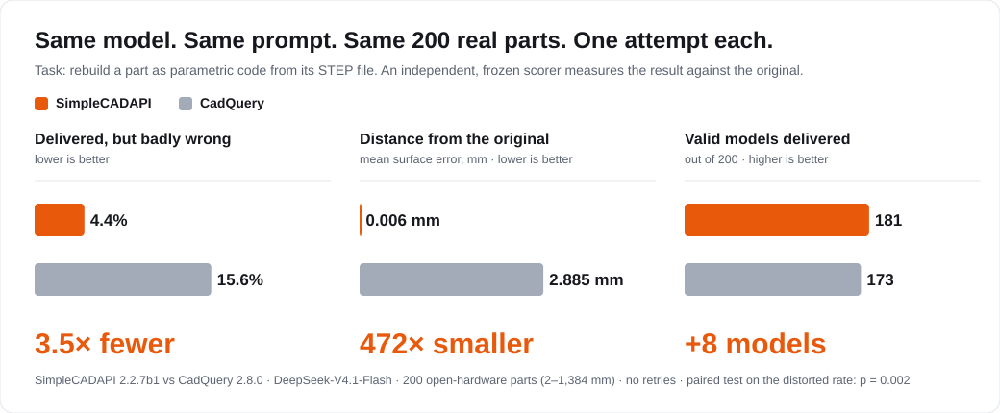
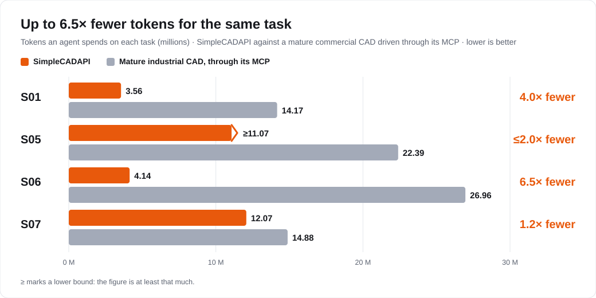
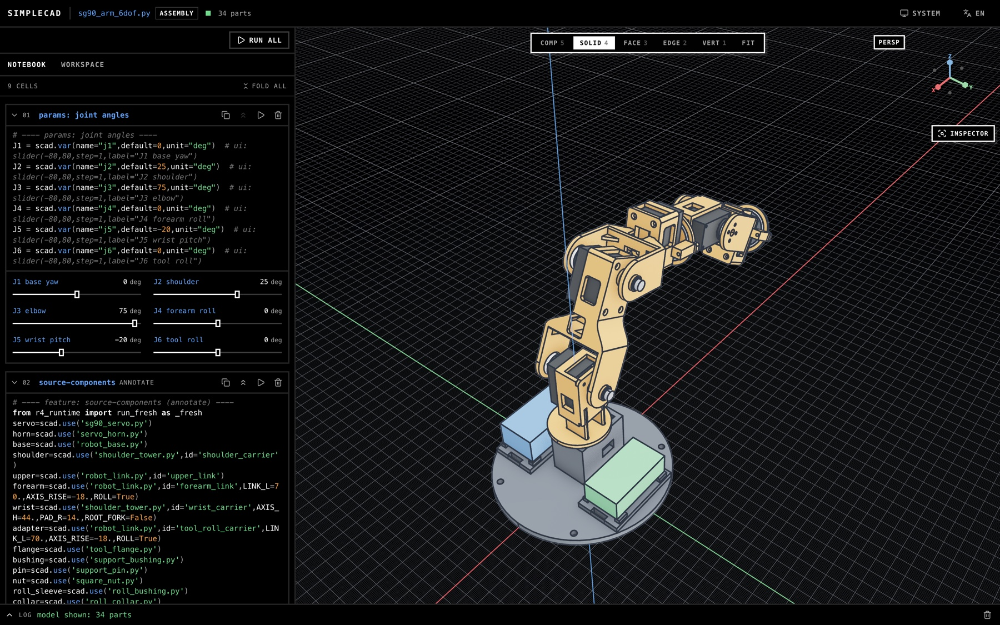
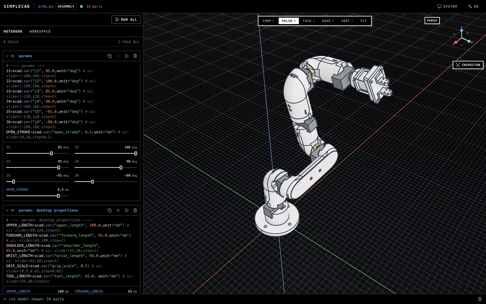

<p align="center">
  
</p>

<h1 align="center">SimpleCADAPI</h1>

<p align="center"><b>Parametric CAD built for agents.</b><br/>Efficient · Low-overhead · Agent-native</p>

<p align="center"><a href="README.zh-CN.md">中文</a> · <a href="CHANGELOG.md">Changelog</a> · <a href="docs/skill-design.md">Skill design</a> · <a href="https://arxiv.org/abs/2608.00891">Paper</a></p>

**Start here.** Paste this line to your coding agent (Claude Code, Codex, OpenCode, …):

```text
Read physpace.dev/sca/landing.md and landing me on this sdk.
```

It installs the SDK, installs the skill for itself, opens a real example in the editor, and shows you how to work with it.

---

## The idea

CAD software was made for a person with a mouse. An agent has no mouse. It has code, a context window and a token bill.
SimpleCADAPI starts from that.

|  |  |
| --- | --- |
| **Efficient** | More first attempts come out right, and fewer tokens are spent getting there. Change one parameter and only the cells that depend on it run again. |
| **Low-overhead** | One `pip install`: the geometry engine is native C++ on OpenCASCADE inside the wheel, with no CadQuery or OCP stack. A functional API with no hidden state, so every step is a cell that can be cached, checked and replayed. A skill an agent reads in one batch, not twenty. |
| **Agent-native** | Errors say what happened, give the measured numbers and say how to fix it. Geometry is selected by what it *is* (`ql`, stable `scad.ref`), not by an index that moves. Every call is recorded as a replayable graph. The editor writes what you click into the notebook, so your agent reads your selection from disk. |

## The evidence

**Against CadQuery.** Same model, same prompt, same 200 real parts, one attempt each. A frozen, independent scorer compares each result with the original.

<p align="center"></p>

<sub>DeepSeek-V4.1-Flash, SimpleCADAPI 2.2.7b1 vs CadQuery 2.8.0, 200 open-hardware parts from 27 projects. "Badly wrong" is a delivered model whose surface F1 at 1 mm is below 99.99 %. Disclosed in the report: the SimpleCADAPI run also had a STEP-reconstruction workflow guide, the CadQuery run a general third-party CadQuery skill; the parts are mostly simple (median 19 faces).</sub>

**Against a mature industrial CAD.** Tokens spent per task; the industrial CAD is driven through its MCP server.

<p align="center"></p>

## What it builds

Two six-axis arms, each an assembly of part notebooks composed with `scad.use`. Every joint angle and link length is a named parameter: drag a slider and the model follows.

<p align="center"></p>

**SG90 educational arm** · 34 parts, six revolute joints solved as constraints, 3D-printable links, reserved envelopes for the electronics. `sg90_arm_6dof.py`

<p align="center"></p>

**Desktop six-axis arm with gripper** · 34 parts. The joint motor is a purchased part with its real mounting interface (34 × 20 × 19.6 mm body, six M2 holes on a Ø10.5 circle), and the links carry the matching pockets, screw channels and plug windows. `arm6.py`

The editor, `sca edit`, is code-first: cells on the left, the live model on the right, a slider for every parameter. Click a solid, face, edge or vertex and it writes a selection into the notebook. Your agent reads what you picked from the file, so "chamfer these two edges" needs no ids. The editor and `sca run` share one runtime and one per-cell cache; on the six-axis arm a joint angle already seen re-renders in 0.6 s, a new one in 2.7 s (2.2.7).

## The skill

The skill is how an agent learns the SDK. It is a router and a library of small pages, written so the agent reads exactly what a step needs, in one parallel batch.

**What it does** — seven routes, each a complete workflow with its own checks:

| Ask | Route |
| --- | --- |
| Model one physical part | single-part modeling: requirements → plan → build → verify |
| Build a multi-part product or mechanism | assembly: connectors, constraints, kinematics, standard parts |
| Rebuild an editable model from a STEP file | STEP reconstruction with stable entity ids and acceptance gates |
| Rebuild from a mesh, point cloud or photos | scan reconstruction |
| Rebuild from a vector-PDF drawing | drawing reconstruction |
| Produce a GB engineering drawing (DXF) | engineering drawing from validated geometry |
| Hand the model to someone else | export and translation: STEP AP242, STL, FreeCAD, MJCF |

**How it is organized**

```text
SKILL.md                  router: pick one route, read its batch (≤ 130 lines)
workflows/                one lifecycle per route; roles and stages load when they start
domains/                  what the SDK offers for a kind of task
discipline/               rules and invariants: core rules, feature order, verifiers, failure and repair
docs/api · stdlib · core  400+ generated signature pages; a method with no page does not exist
```

- **Small reading budget.** The first batch of any route is at most 1,200 lines. Every page has one job, and every rule has one home. A build check fails the skill if a page breaks the contract.
- **Two modes.** Every workflow runs interactive (a person can answer) or unattended (nobody will). The mode changes who decides, never what is checked.
- **One source, seven harnesses.** The same pages compile for Claude Code, Codex, OpenCode, ZCode, OMP, DSH and Kimi Code.

```bash
sca skill targets            # the harnesses
sca skill install            # compile for yours and install
```

## Plugins

Modeling is the SDK's job. Checking, simulating and translating a finished model belong in a plugin, and a plugin is a repository:

```text
sca-addon.toml     machine-checked facts: name, version, which SDK versions, how to provision
skill/SKILL.md     everything an agent reads about it
...                its own code, binaries and docs, in any language
```

```bash
sca addon add owner/repo          # from GitHub; owner/repo@v1.2.0 pins a tag
sca addon add ./my-addon          # a local checkout
sca addon list                    # what is installed, and whether its runtime works
sca addon update                  # re-fetch; code is swapped, runtime state is kept
```

- **The agent learns it on install.** The addon's skill lands beside the SDK's as `sca-<name>`, so the agent gets the capability and the instructions together.
- **Isolated by design.** A plugin reads `.scadpkg` product packages across a process boundary and runs in its own environment, so plugin dependencies never touch the one that models geometry.
- **Already in use.** Connector verification (bolted, pinned, press-fit, welded and other joints, checked and then run through FEM) and FEM mesh preparation (fasteners removed, their holes filled, closure proven) are plugins. The AP242 → Gmsh → CalculiX and MJCF → MuJoCo paths below run off the same package.

<table>
<tr>
<td width="34%" align="center" valign="top" rowspan="2">
<br/>
<b>L-bracket static FEM</b><br/>CalculiX von Mises on the Gmsh mesh of the AP242 export; faces are chosen by <code>interface.*</code> tags that survive model changes
</td>
<td width="33%" align="center" valign="top">
<br/>
<b>Four-bar linkage, first pass</b><br/>MuJoCo shows the links crossing: the assembly is wrong
</td>
</tr>
<tr>
<td width="33%" align="center" valign="top">
<br/>
<b>After the collision pass</b><br/>the same crank cycle sweeps clean
</td>
</tr>
</table>

## Install

```bash
pip install "simplecadapi[editor]"      # the SDK and the editor
sca example u_link                       # a real workspace to open
sca edit u_link                          # the editor
sca skill install                        # the skill for your agent
```

Python 3.10–3.13 on Linux, macOS and Windows. `uv tool install "simplecadapi[editor]"` puts `sca` on your PATH without a virtual environment. `sca run model.py` runs a notebook headless; `sca export` writes STEP, STL and OBJ.

## Research artifact

This repository is an artifact of [**CADIR: A Cross-Backend Editable Intermediate Representation for Agentic CAD Generation**](https://arxiv.org/abs/2608.00891).

Apache-2.0. Validate generated models before production use.
