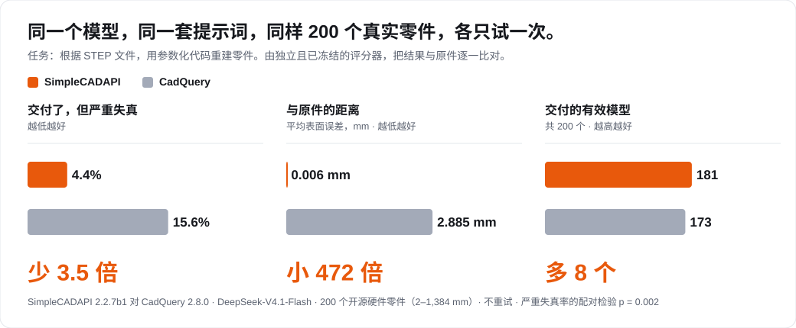
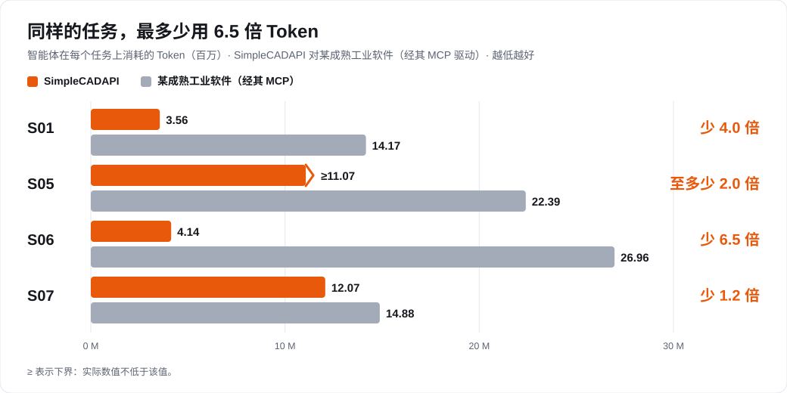
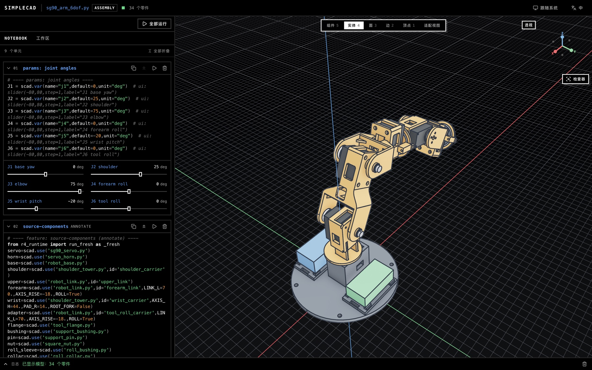
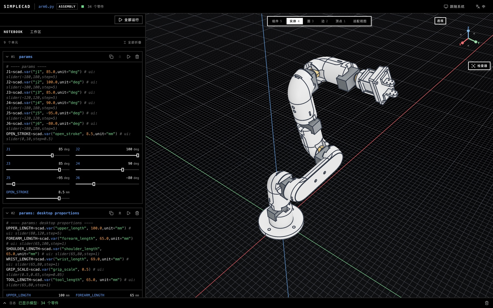

<p align="center">
  
</p>

<h1 align="center">SimpleCADAPI</h1>

<p align="center"><b>为 Agent 而生的参数化 CAD。</b><br/>高效率 · 低开销 · Agent Native</p>

<p align="center"><a href="README.md">English</a> · <a href="CHANGELOG.md">更新日志</a> · <a href="docs/skill-design.md">Skill 设计</a> · <a href="https://arxiv.org/abs/2608.00891">论文</a></p>

**从这里开始。** 把下面这句话发给你的 coding agent（Claude Code、Codex、OpenCode 等）：

```text
Read physpace.dev/sca/landing.md and landing me on this sdk.
```

它会帮你安装 SDK、为自己安装 skill、在编辑器里打开一个真实示例，并教你怎么和它一起工作。

---

## 理念

CAD 软件是为握着鼠标的人做的。Agent 没有鼠标，它只有代码、上下文窗口和 Token 账单。
SimpleCADAPI 从这一点出发。

|  |  |
| --- | --- |
| **高效率** | 一次尝试就做对的更多，花的 Token 更少。改一个参数，只有依赖它的单元会重新运行。 |
| **低开销** | 一条 `pip install`：几何引擎是 wheel 里的原生 C++（基于 OpenCASCADE），没有 CadQuery 或 OCP 那一整套依赖。函数式 API、没有隐藏状态，每一步都是可以缓存、检查、重放的单元。Skill 让 agent 一批读完所需内容，而不是读二十次。 |
| **Agent Native** | 报错会说清发生了什么、给出带单位的实测数值、告诉你怎么修。按“几何是什么”选择对象（`ql`、稳定的 `scad.ref`），而不是靠会漂移的序号。每次调用都被记录成可重放的图。编辑器把你点选的内容写进 notebook，agent 直接从文件里读到你的选择。 |

## 数据

**对 CadQuery。** 同一个模型、同一套提示词、同样 200 个真实零件，各只试一次。由独立且已冻结的评分器，把每个结果与原件比对。

<p align="center"></p>

<sub>DeepSeek-V4.1-Flash，SimpleCADAPI 2.2.7b1 对 CadQuery 2.8.0，来自 27 个项目的 200 个开源硬件零件。“严重失真”指已交付、但 1 mm 阈值下表面 F1 低于 99.99 % 的模型。报告中已披露：SimpleCADAPI 一组另有 STEP 逆向重建的工作流文档，CadQuery 一组用的是通用的第三方 CadQuery skill；零件以简单件为主（面数中位数 19）。</sub>

**对某成熟工业软件。** 每个任务消耗的 Token；该工业软件通过其 MCP 服务驱动。

<p align="center"></p>

## 它能做什么

两台六轴机械臂，都是由零件 notebook 通过 `scad.use` 组合出来的装配体。每个关节角和连杆长度都是命名参数：拖动滑块，模型跟着动。

<p align="center"></p>

**SG90 教学机械臂** · 34 个零件，六个转动关节作为约束被求解，连杆可 3D 打印，为电子元件预留了空间。`sg90_arm_6dof.py`

<p align="center"></p>

**带夹爪的桌面六轴机械臂** · 34 个零件。关节电机是带真实安装接口的采购件（机体 34 × 20 × 19.6 mm，Ø10.5 圆周上六个 M2 孔），连杆上开有对应的腔体、螺钉通道和插接窗口。`arm6.py`

编辑器 `sca edit` 是代码优先的：左边是单元，右边是实时模型，每个参数都有滑块。点选实体、面、边或顶点，它就把一条选择写进 notebook。Agent 从文件里读到你选了什么，所以“把这两条边倒角”不需要任何 id。编辑器和 `sca run` 共用同一个运行时和同一份逐单元缓存；在六轴臂上，见过的关节角 0.6 秒重新渲染，新角度 2.7 秒（2.2.7）。

## Skill

Skill 是 agent 学会使用 SDK 的方式。它是一个路由页加一批小页面，写成让 agent 恰好读到一步所需的内容，并且一批并行读完。

**能做什么** —— 七条路线，每条都是带自检的完整工作流：

| 你要 | 路线 |
| --- | --- |
| 建一个实体零件 | 单零件建模：需求 → 规划 → 构建 → 验证 |
| 建多零件产品或机构 | 装配：连接器、约束、运动学、标准件 |
| 从 STEP 文件重建可编辑模型 | STEP 逆向重建，稳定实体 id 与验收门 |
| 从网格、点云或照片重建 | 扫描重建 |
| 从矢量 PDF 图纸重建 | 图纸重建 |
| 出国标工程图（DXF） | 由已验证的几何生成工程图 |
| 把模型交给别人 | 导出与转译：STEP AP242、STL、FreeCAD、MJCF |

**怎么组织**

```text
SKILL.md                  路由：选一条路线，读它的那一批页面（≤ 130 行）
workflows/                每条路线一个生命周期；角色与阶段在开始时才加载
domains/                  某类任务上 SDK 提供什么
discipline/               规则与不变量：核心规则、特征顺序、验证脚本、失败与修复
docs/api · stdlib · core  400+ 页自动生成的签名；没有页面的方法就不存在
```

- **阅读预算很小。** 任何路线的第一批最多 1,200 行；每页只做一件事，每条规则只有一个家。构建检查会在页面违反约定时让 skill 构建失败。
- **两种模式。** 每个工作流都分交互式（有人可以回答）和无人值守（没人回答）。模式改变的是谁来决定，而不是检查什么。
- **一份源码，七个 harness。** 同一批页面可编译给 Claude Code、Codex、OpenCode、ZCode、OMP、DSH 和 Kimi Code。

```bash
sca skill targets            # 支持的 harness
sca skill install            # 为你的 harness 编译并安装
```

## 插件

建模是 SDK 的事。对建好的模型做检查、仿真、转译，属于插件；一个插件就是一个仓库：

```text
sca-addon.toml     可机器检查的事实：名称、版本、兼容的 SDK 版本、如何准备运行环境
skill/SKILL.md     agent 读到的关于它的一切
...                它自己的代码、二进制和文档，任何语言都行
```

```bash
sca addon add owner/repo          # 从 GitHub 安装；owner/repo@v1.2.0 锁定标签
sca addon add ./my-addon          # 本地目录
sca addon list                    # 已装了什么，运行环境是否可用
sca addon update                  # 重新拉取；代码被替换，运行时状态保留
```

- **装上即会用。** 插件的 skill 会以 `sca-<名字>` 装在 SDK 的 skill 旁边，agent 同时得到能力和使用说明。
- **天然隔离。** 插件通过进程边界读取 `.scadpkg` 产品包，在自己的环境里运行，因此插件的依赖不会碰到做几何建模的那套环境。
- **已经在用。** 连接器验证（螺栓、销、过盈、焊接等连接，先检查再送入有限元）和有限元网格预处理（移除紧固件、补上它们的孔、证明闭合）都是插件。下面的 AP242 → Gmsh → CalculiX 与 MJCF → MuJoCo 两条链路，用的是同一个产品包。

<table>
<tr>
<td width="34%" align="center" valign="top" rowspan="2">
<br/>
<b>L 形支架静力有限元</b><br/>AP242 导出经 Gmsh 划分网格，CalculiX 算出 von Mises；边界面由模型改动后仍保留的 <code>interface.*</code> 标签选取
</td>
<td width="33%" align="center" valign="top">
<br/>
<b>四连杆，第一版</b><br/>MuJoCo 里连杆互相穿过：装配是错的
</td>
</tr>
<tr>
<td width="33%" align="center" valign="top">
<br/>
<b>碰撞修正之后</b><br/>同一个曲柄周期，干净地转完
</td>
</tr>
</table>

## 安装

```bash
pip install "simplecadapi[editor]"      # SDK 和编辑器
sca example u_link                       # 一个可以直接打开的真实工作区
sca edit u_link                          # 编辑器
sca skill install                        # 给你的 agent 装 skill
```

Python 3.10–3.13，Linux、macOS 和 Windows。`uv tool install "simplecadapi[editor]"` 不需要虚拟环境就能把 `sca` 放进 PATH。`sca run model.py` 无界面运行 notebook；`sca export` 导出 STEP、STL 和 OBJ。

## 研究 artifact

本仓库是 [**CADIR: A Cross-Backend Editable Intermediate Representation for Agentic CAD Generation**](https://arxiv.org/abs/2608.00891) 的 artifact。

Apache-2.0。生产使用前请验证生成的模型。
