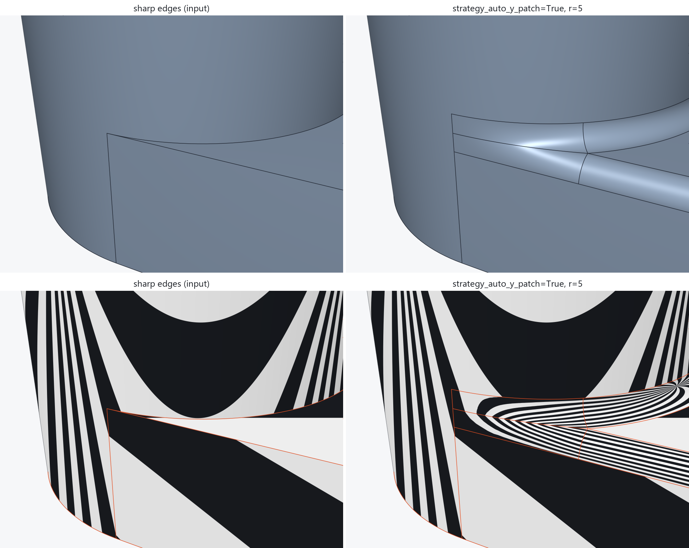

# Y-patch fillets and graph patches as kernel strategies

Decision record for branch `feat/y-patch-graph-patch` (2026-11-23). Kernel patch set `fillet-robustness-4`; development
prefix `C:/OCCT-modified/static-ypatch` (MinGW 15.2, static), built from this checkout with
`src/cpp/tools/build_occt.py`. The earlier prefix `C:/OCCT-modified/static` is left untouched as the control.

## What started it

The owner's request (paraphrased): the Y-shaped fillet is a general situation, not one sample — it covers the whole family of
tangent or nearly tangent junctions of one convex and one concave fillet. Detect that geometric situation and run a specific
path for it, as a kernel capability with a proper strategy branch, not as judgement in the Python layer (slow) nor in the
SDK's C++ business layer (couples the SDK to one kernel). Expose it on `fillet_rsolid` as an explicit named boolean
(`strategy_auto_y_patch`). Do the same for the graph patch: a new kernel capability with a good SDK interface. Judge
continuity with zebra renderings and keep the pictures for the changelog.

## What was found (checked by running)

| Finding | Evidence |
| --- | --- |
| `BRepFilletAPI_TangentY` (PR #98) cannot serve a real part | `TryBuild` accepts only the canonical plate/post at the origin (plate `3R x 2R x h`, post `2h`) after a boolean comparison with it, then rebuilds the whole solid from hard-coded faces |
| Stock OCCT does not chain the two edges | `BRepFilletAPI_MakeFillet` makes two contours (arc, line); each alone gives an invalid solid with self-interference |
| The patched kernel (0001–0003) | concave arc alone: valid; convex line alone: invalid (2 interferences); both: `IsDone() == false` |
| The standard result depends on the order of `Add` | the same edges added in another order changed "not done" into "done" on some cases; the test harness adds in pick order |
| Two rolling-ball bands cannot meet at such a vertex | the concave ball centre lies outside the material and the convex one inside; both bands claim the same wedge of the common face |

## Decisions

**D1. The strategy lives in the kernel, behind the standard entry point.** `BRepFilletAPI_MakeFillet::SetYPatch(true)`
(patch `0004`) is the only switch; `Build()` runs the Y path when there is a junction and the transition passes its gates,
otherwise the standard algorithm, unchanged. `Generated` / `Modified` / `IsDeleted` answer from the Y path's history, so the
SDK's tracking and tags (`fillet.patch` on bands and ribbons) need no special case. `NbYPatches()` and `YPatchJunction(i)`
report what was done (vertex, P*, measured seam and band angles). Off by default: a result of the standard algorithm is
bit-identical to before. Rejected: dispatching in Python or in `src/cpp/src/ops` (the owner's constraint: speed and kernel
migration); keeping `TangentY` (canonical sample only).

**D2. Detection is OCCT's own convexity, at a vertex.** A junction is a vertex V with a selected concave edge `Ein = T ∩ A`
and a selected convex edge `Eout = T ∩ B` (`ChFi3d::DefineConnectType`), sharing the face T, where A and B meet along an
unselected edge and their normals at V differ by at most 20° (near tangency included). Constant radius per contour; the two
radii may differ.

**D3. Construction: the standard algorithm does everything it can; the kernel adds only the junction.**
1. P*: solve the two rolling balls (Newton on both contacts and the normal plane of the rail), find the first crossing of
   their contact curves on T, refine (λin, λout). On the reference sample P* equals the analytic `x = 2√(Rr)` to 1e-5 mm.
2. Cut V's wedge out of T, A and B (`BRepAlgoAPI_Splitter` with edges on the supports: the end sections' traces, and the
   ribbons' boundaries), leaving an open shell whose free boundary holds each band's end section at a vertex.
3. Fillet the open shell with the standard algorithm: both bands end at their sections through P*; their far ends, and
   every other selected edge, are the standard algorithm's.
4. Two ribbons, each tangent to its own support (contact curve, then back along the support to V), to its band at the end
   section, and to the other ribbon along a seam on T from V to P*. Clamped cubic Hermite tensor product on cosine-spaced
   nodes (the construction `TangentY` validated); sections are cubic Bézier curves blended into the exact circular section
   near the band; both ribbons share the seam's exact end derivatives so that they interpolate the same seam curve.
5. Sew, make the solid; gates: `BRepCheck_Analyzer`, `BOPAlgo_CheckerSI` level 5, every free edge closed. Any failure:
   the Y path returns false and the standard algorithm runs.

**D4. Explicit named booleans in the SDK.** `fillet_rsolid(..., strategy_auto_y_patch=False)` and
`make_surface_patch_rface(..., strategy_graph_patch=False)`; recorded in the operation graph only when true (records of the
standard path are unchanged), replayed by the serializer and the C++ executor. The SDK compiles against any OCCT: the
strategies are found with `__has_include`, a kernel without them raises `ValueError` naming the patch set, and
`simplecadapi._cpp._kernel_capabilities()` says which strategies the linked kernel has.

**D5. The graph patch is a fill strategy, not a new operator.** It answers the same question as
`make_surface_patch_rface` (fill a constrained boundary loop) with a different kernel method; the SDK's `SurfaceFitter`
interface is where fill methods are chosen (`FillingProblem::graph_patch`). Preconditions are checked before the kernel
call: 3–64 boundaries, a support on each, each edge an edge of its support, no points, holes or settings.

## Not done

**D6. Periodic supports are re-seated first.** `make_cylinder_rsolid` puts the cylinder's parametric seam at +X, on the
post's root: the standard algorithm, starting a band at the open shell's free boundary and crossing that seam vertex,
built the band twice (coincident tori, self-intersecting wires). Scanning the seam angle in 45° steps showed the failure
exactly when the seam touches a chain the standard algorithm finishes. Before the pipeline, a periodic support (cylinder,
cone, sphere, torus, revolution) whose seam has a vertex on a selected edge is rebuilt on the same surface with its
parametric origin turned into the largest gap between the selected edges' pcurves (point set unchanged); the replacement
is part of the history. The old seam's vertex is then merged away (edges only, `ShapeUpgrade_UnifySameDomain`), so the
root is one edge again: with the vertex left in place, small radii (1, 2.5) still failed. Rejected: splitting the face without moving the origin (still fails); a text round trip of the
open shell (made a marginal case pass, but by perturbing digits).

**D7. History is checked strictly through the public entry point.** The family's check calls
`BRepFilletAPI_MakeFillet` with `SetYPatch` and requires: no input face reported deleted (every one is trimmed, not
consumed), every image in the result, each junction edge generating at least its band and its ribbon, every result face
traced to an input face or edge. The lenient first check ("kept, modified or deleted") had hidden four defects (sewing
history queried for whole shapes instead of sub-shapes, chain-propagated edges without generated faces, a lossy
`BRepTools_History::Merge`, and a two-pass ordering that only the `MakeFillet` path exposed).

## Case family (`src/cpp/patches/occt/tests`, `cases.exe`; 2026-11-23, static MinGW prefix)

Every successful case: valid (`BRepCheck_Analyzer`), no self-interference (`BOPAlgo_CheckerSI` level 5), strict history
through `MakeFillet + SetYPatch`. Angles: largest normal angle across the ribbon seam / between a ribbon and its band or
support. "Standard" is the patched kernel without the strategy, edges added in pick order.

| Cases | Standard | Y patch | Seam ° | Band ° |
| --- | --- | --- | --- | --- |
| post flush with the plate side, r = 1, 2.5, 5, 8, 12; one or both sides; arbitrary placement | not done (r = 12: valid) | ok, P* = 2√(Rr) to 1e-4 mm | 5e-4 – 4e-3 | 3e-3 – 1e-2 |
| cylinder seam at 0° … 315° (8 cases); seam on the root (the SDK's default) at r = 1, 2.5, 5, 8, 12, one or both sides, also on the SDK's own exported solid | mostly valid; seam at 90°: invalid, 2 interferences; on the root: not done | ok | 2.3e-3 | 6.9e-3 |
| unequal radii, concave 3 / convex 7 and 7 / 3 | valid | ok | 0.059 | 0.010 |
| plate side turned 2°, 5°, 10° outward; 2°, 5° inward | valid | ok | 2e-3 | 6e-3 |
| planar wall 5°, 10°, 15° off the plate side | 5°: not done; 10°, 15°: valid | ok | < 1e-9 | 2.2e-3 |
| wall 5° with a junction longer than the edge | not done | refused, as required | – | – |
| curved plate side (R 140 arc tangent to the post) | not done | ok | 3.9e-3 | 5.7e-3 |
| inclined common face (slope 0.15) | not done | ok | 3.7e-3 | 8.6e-3 |

Times 175–560 ms per solid (one or two junctions), including both gates.

Where the standard algorithm already returns a valid solid, the strategy replaces its corner by the Y transition; those
standard shapes were not compared visually. Pictures (`tools/render/zebra.py`): `img/y-patch/`.

## Not done

- Variable-radius contours never take the Y path.
- The seam lies on T; Plasticity's seam dips slightly below T in the middle. Shape choice, not a defect.
- Near tangency (A and B meeting at a sharp edge of a few degrees) the ribbons inherit that kink at the junction vertex
  itself (visible in the 10° wedge zebra picture); G1 holds along the seam, the bands and the supports.
- Unequal radii keep G1 to 0.06°, ten times the equal-radius figure; the seam normal field is a blend chosen for equal
  radii.
- Only MinGW static builds were run. CI builds the kernel from this patch set on Linux; MSVC was not compiled here.
- The graph patch is exposed with its research acceptance (C0/G1/G2 loops, planar-representable); the SDK tests cover a
  wall loop (C0) and a hole in a plane (G1, G2).

## Addendum (2026-11-23, evening)

**D8. A plain fillet falls back to the Y transition.** The owner asked that the tangent post/wall case work without the
flag. `MakeFillet::Build` runs the standard algorithm; at a detected junction, a standard result that is not done,
invalid or self-intersecting is replaced by the Y transition (`YPatchFallback()`). A valid standard result is kept: at a
wall 10° off the plate side the standard algorithm merges both bands into one tapering band whose zebra stripes are
smooth, while the Y transition is G1 only. The non-Y "pinch" corner (Plasticity with Y-Blend off) was built as research
code, off: valid on near-tangent cases, self-intersecting on exact tangency.

**D9. The graph patch continues curved supports.** A tube window was refused because the exact boundary solve demanded
1e-5 that a degree-8 graph cannot meet on a cylinder. The patch now follows the supports' surfaces over the hole, fits
boundary and support together when the exact solve fails, and accepts on the built face (gap ≤ 1e-3 mm, angle ≤ 1e-3 rad,
G2 cross-curvature within 5 %). Tube window G1: 2.3e-4 mm from the cylinder (plate filling: 0.39 mm).

Comparison report with code pairs and pictures: `out/report/REPORT.pdf` (local).

**D10. The pinch corner is the default fallback (2026-11-24).** Owner: a qualified engine must make the non-Y corner
(Plasticity's Y-Blend off: both bands taper to one point, 10 faces) work, exact tangency included. The first attempt
folded near V because it fitted sampled positions with the ribbons' tensor Hermite fit, while the section radius
collapses like x²/4R. Each pinch band is now an exact variable-radius rolling-ball surface: exact circular sections
(rational quadratic, weight cos θ/2), only 1D data interpolated along the rail, a degenerated edge at V; the shared
curve on T is solved from radius laws h, g ~ s² whose sum fills the cusp width. All 47 non-refused cases succeed
as pinch (valid, SI(5) = 0, strict history); the plain `MakeFillet` rescues all 21 cases whose standard result fails,
none needing the Y. Geometric limit: at P*'s section a pinch band, tangent to T along the shared curve with circular
sections, cannot be G1 to both constant-radius bands, whose T-contacts cross at P* (≈35° at r = 5): the crease can only
be distributed. Default `pinchDir = 1` balances it (7.5° / 8.0° at flush r5); `0` makes the convex side G1 (17.3° on the
concave side), which Plasticity's face layout suggests it does. Against Plasticity Y-off (exact sample points to ours):
0.078 / 0.262 mm RMS / max at r5, about a third of the distance to its Y-on result.

**D11. The pinch crease goes to the concave side, as in Plasticity (owner, 2026-11-24).** The pinch tries the law that
keeps the convex band G1 at P*'s section first (concave crease ≈ 17° at flush r5); where the cusp is too narrow for it
(r = 1, the curved side) or it would leave a crease above 30° (the inclined top measured 90°), the balanced law. Case
family: failures 0; 33 junctions convex-G1, 10 balanced, largest crease 23.6°; every case whose standard result fails
takes the pinch.
