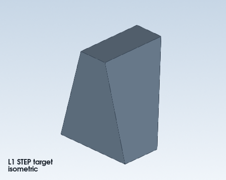

# Whole-body STEP loft and sweep reconstruction cases

Use these cases after choosing `step-reconstruction.md`. They demonstrate the
report-first gate and the distinction between a changing section and a fixed
section. The runnable sources are in
`examples/step_reconstruction_loft_sweep/` in the repository checkout.

| Case | Parsed whole-body feature | First API | Decision |
| --- | --- | --- | --- |
| L1 | Two differently sized, parallel rectangular sections | `loft_rsolid` | Section shape changes; a ruled loft is the first candidate. |
| S1 | One rigid rectangular section along a curved path | `sweep_rsolid` | Profile is unchanged; sweep frame is checked against the STEP. |
| P1 | Three changing rectangular sections along a curved path | `loft_multisection_rsolid` | Section shape changes while a spine constrains ordering. |

## Preview




## Reproduce and read the evidence

From the repository root, with SimpleCADAPI and its inspect extra installed:

```powershell
$env:PYTHONPATH = (Resolve-Path src).Path
python examples/step_reconstruction_loft_sweep/analyze.py
python examples/step_reconstruction_loft_sweep/reconstruct.py
```

For each case, inspect `out/<case>/analysis/parse-report.md` and
`out/<case>/reconstruction/analysis-evidence.md` before the notebook source.
The runner calls `inspect_analysis_package_rdescriptor`, reads the complete
report and the catalog, hypotheses, specialist analysis, section index, and
unresolved list, and writes one evidence row per recognized feature before
starting the first notebook. A missing or stale report blocks construction.
L1 takes its profile dimensions, final contour, end location, and ruled choice
from that saved evidence.

The first S1 and P1 candidates use the report's recovered spline proxy. Their
strict comparisons fail, so the example tries a second control-point
hypothesis supplied in the notebooks; S1 also changes the sweep frame. Inspect
`iterations.json`, per-attempt comparison files, `feature-checklist.json`, and
`verdict.json`. These synthetic cases demonstrate verification of a candidate.
They do not implement automatic recovery of the original control points.

Only the three whole-body cases are guide routes. A local feature within a
larger solid still follows the general STEP reconstruction workflow.
