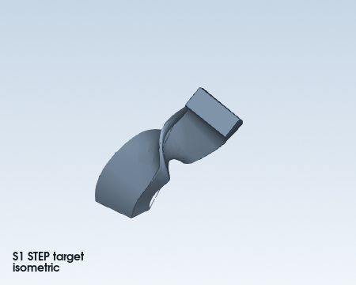
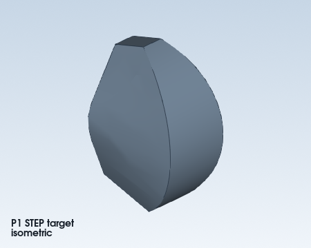

# STEP reconstruction: whole-body loft and sweep

These three synthetic targets separate the two feature families:

| Case | Target | Recognition | Reconstruction |
| --- | --- | --- | --- |
| L1 | Two differently sized rectangular sections | Whole-body variable-section loft | `loft_rsolid` |
| S1 | One fixed rectangular section transported along a curve | Whole-body path sweep | `sweep_rsolid` |
| P1 | Three changing rectangles constrained by a curved spine | Whole-body path loft | `loft_multisection_rsolid` |






Run from the repository root with the inspect extra installed:

```powershell
$env:PYTHONPATH = (Resolve-Path src).Path
.\.venv\Scripts\python.exe examples/step_reconstruction_loft_sweep/analyze.py
.\.venv\Scripts\python.exe examples/step_reconstruction_loft_sweep/reconstruct.py
```

`target_fixtures.py` generates the test targets only. `reconstruct.py` never
imports it. Each reconstruction first validates and fully reads the saved
`out/<case>/analysis/` package. It writes
`out/<case>/reconstruction/analysis-evidence.md` before running the marimo
notebook. L1 parameters come from the report and final saved section contour.
The first S1 and P1 candidates use the report's spline proxy; failed
comparisons lead to a second control-point hypothesis supplied in the
notebooks. These synthetic targets demonstrate verification of a hypothesis;
the examples do not implement automatic recovery of the original controls.

Each attempt produces a durable `.scadpkg`, a STEP exported from that package
in a fresh Python process, a roundtrip STEP, a validity-checked bidirectional
material comparison, and strict comparison diagnostics.
`feature-checklist.json` separately checks every recognized feature against
the candidate catalog. `verdict.json` is written only after those checks pass.
All generated data stays in the ignored `out/` folder.
